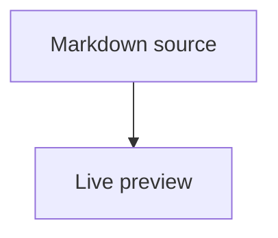

# Markdown Studio

A Windows desktop Markdown writer and reader with a real **Preview only** mode.

## Find and replace

The **Search** menu provides highlighted Find (`Ctrl+F`) and Replace (`Ctrl+H`)
for the active Markdown tab. Search is case-insensitive by default and supports
case-sensitive substring or whole-word exact matching. Navigate to the next or
previous match, replace the current match, or replace all matches at once.

## Multiple document tabs

Markdown Studio can keep multiple Markdown files open at the same time. New documents and opened files appear in separate, movable tabs. Each tab keeps its own file path, content, undo history, preview, scroll position, splitter position, and unsaved-change state. The active tab is used by Save, Save As, Find, formatting, export, and preview commands.

**File → Open** supports selecting several files at once. An already-open file is activated instead of duplicated. Close a tab with its close button or `Ctrl+W`; Markdown Studio prompts only when that tab contains unsaved changes. An asterisk beside a tab name identifies unsaved content.


## File association

Markdown Studio accepts a Markdown filename on its command line. After Windows associates `.md` files with `MarkdownStudio.exe`, double-clicking a Markdown file opens that file instead of the default new-document text. Rebuild the EXE after updating the source.

Markdown Studio uses one running application instance. If the application is already open, later command-line launches—including Windows double-clicks—send their Markdown files to the existing window, where they open as tabs. Launching the application again without a filename activates the existing window.

## Display modes

| Mode | Shortcut | Result |
|---|---:|---|
| Split view | `Ctrl+1` | Editor and preview |
| Editor only | `Ctrl+2` | Markdown source only |
| Preview only | `Ctrl+3` | Rendered document only |
| Full screen | `F11` | Toggle full-screen window |

Unlike a collapsed splitter, Preview only actually hides the editor widget, so the preview receives the entire application area.

Ctrl+double-click rendered text in the preview to locate its corresponding Markdown source. Markdown Studio opens Split view when required, scrolls the editor to the matched location, moves the cursor there, and gives the editor focus.

## Formatting toolbar

The second toolbar provides Bold, Italic, Strikethrough, text colour, background colour, ordered list, bullet list, task, table, link, image, H1–H5, paragraph, code, quote and horizontal-rule buttons. Select text before pressing a button to format the selection. Code blocks ask for a language so the preview can apply syntax highlighting.

It also includes **Clear formatting**, which cleans Markdown and HTML formatting from selected text. Split view restores a true 50/50 layout, and the editor and preview scroll together.

Commands are context-sensitive. Editor formatting, search and Edit-menu commands are enabled only while the editor has focus. Preview zoom commands are enabled only while the preview has focus.

The context status is refreshed when tabs change. In Preview-only mode, switching tabs leaves the Edit menu and formatting toolbar disabled.

Clicking an HTTP, HTTPS or email link in the preview opens it with the Windows default browser or mail application. The preview remains on the Markdown document. In-document heading links continue to navigate inside the preview.

Code blocks use a very light grey background with dark text and a light GitHub-style syntax-highlighting theme.

Syntax highlighting is rendered locally with Pygments and therefore works offline. **Search → Find...** (`Ctrl+F`) opens a search dialog with match highlighting and Next/Previous navigation.

The Help menu contains the bundled user guide and About information. The application includes its own Markdown Studio icon.

## Supported content

- Headings, paragraphs, emphasis, links, images, block quotes and horizontal rules
- Ordered, unordered and nested lists
- Tables, fenced code blocks and syntax highlighting
- Task lists, footnotes and definition lists
- Strikethrough, highlighting, superscript and inserted text
- Admonitions and collapsible details
- Embedded HTML
- Mermaid diagrams
- MathJax inline and display equations
- Local images using paths relative to the opened Markdown file
- Export to standalone HTML and PDF output

Mermaid, MathJax and syntax highlighting are loaded from public CDNs, so those advanced preview features require internet access. Ordinary Markdown and embedded HTML work offline.

## Examples

### Mermaid

````markdown

````

### MathJax

```markdown
Inline: $E = mc^2$

Display:
$$
\sum_{i=1}^{n} i = \frac{n(n+1)}{2}
$$
```

### Admonition

```markdown
!!! note "Remember"
    This is an informational note.
```

## Security note

Embedded HTML is rendered as authored. Open Markdown files only from sources you trust.
