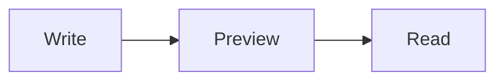

# Markdown Studio feature sample

Use `Ctrl+1`, `Ctrl+2`, and `Ctrl+3` to switch views.

## Formatting

**Bold**, *italic*, ~~strikethrough~~, ==highlight==, H~2~O and x^2^.

> A block quote with a [link](https://www.python.org).

## Lists and tasks

1. Ordered item
2. Another item
   - Nested item

- [x] Preview implemented
- [ ] Write something excellent

## Table

| Feature | Status |
|:--|--:|
| Tables | Ready |
| Footnotes | Ready |

Definition
: A description attached to a term.

Footnotes are supported.[^1]

[^1]: This is the footnote text.

## Code

```python
def greet(name: str) -> str:
    return f"Hello, {name}!"
```

## Mermaid



## MathJax

Inline equation: $E=mc^2$

$$
\int_0^1 x^2\,dx = \frac{1}{3}
$$

## Embedded HTML

<details>
<summary>Click to expand</summary>

This content can be expanded and collapsed.

</details>

!!! tip "Preview only"
    Press **Ctrl+3** to hide the Markdown source completely.
